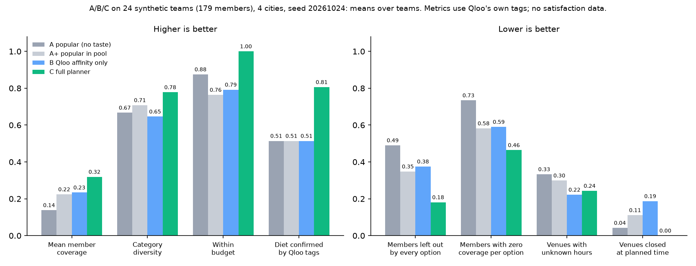

# A/B/C experiment: does the full planner beat simpler rankers?

**Short answer, on synthetic teams.** The full planner (C) scored better than both baselines on member coverage,
members left out, variety, budget fit, dietary evidence and closed-venue avoidance. It did **not** beat
"Qloo affinity only" (B) on unknown opening hours. The lowest member coverage per option stays close to zero for every
strategy. Some of C's wins hold by construction, because C filters on them. This experiment measures **tag-level fit
with Qloo's own data**. It does not measure how happy anyone was: no satisfaction scores were collected or invented.



## What was compared

All four strategies plan the same thing for each team: up to 3 options, each one dinner and one activity.

| Strategy | What it does | Qloo data it uses |
|---|---|---|
| **A popular** | Picks the city's most popular restaurants and activity venues and pairs them by rank. It uses no team input. | One generic query per city and kind, with no signal |
| **A+ popular in pool** (ablation) | Takes the same pools the full planner received and ranks them by Qloo popularity only. | C's pools |
| **B affinity only** | Takes the same pools and ranks them by Qloo affinity to the team's taste signal only. | C's pools |
| **C full planner** | Runs `planOffsite`: affinity, member coverage, team fit, rating, dietary penalty, budget, opening hours, fairness labels and variety. | Its own queries |

All strategies share the same basic hygiene:

- no permanently closed venues
- no hotels as activities
- no repeated venue or chain inside one plan
- at most 3 options

C's ranking logic is unchanged for the experiment. The code is in [`src/agent/baselines.ts`](../src/agent/baselines.ts)
(pure functions, unit-tested in `tests/baselines.test.ts`) and [`scripts/experiment.ts`](../scripts/experiment.ts).

## Synthetic teams

- **Size:** 24 teams, 6 in each supported city (Amman, Dubai, Riyadh, Cairo), 179 members in total.
- **Seed:** `20261024`, using a mulberry32 PRNG, so the teams are fully reproducible.
- **Members:** 4 to 12 per team, with synthetic first names. Each team draws 1 to 3 cuisine clusters (levant, western,
  asian, light) and 1 to 3 activity clusters (culture, active, outdoor, social).
- **Tastes:** each member picks 1 to 3 cuisines and 1 to 2 activities from one of their team's clusters, with common
  items more likely. Sometimes they add one taste from outside the cluster (25% for cuisine, 20% for activity).
- **Diets:** illustrative rates of halal 35%, vegetarian 12%, gluten-free 6% and vegan 4%. All 24 teams ended up with
  at least one dietary need.
- **Budget:** 25, 35, 45, 60 or 80 USD per person, converted to local currency.
- **Date:** spread across 2026-11-03 to 2026-12-31. The start time is 18:00 (activity first, then dinner).
- **Artists:** none, so no Qloo search calls were needed.

## Metrics (per team, averaged over its options, then averaged over teams)

| Metric | Definition |
|---|---|
| Mean member coverage | Each member's score for an option is (dinner carries a tag for one of their cuisines + activity carries a tag for one of their activities) / 2. This is the mean over members. |
| Lowest member coverage per option | The lowest member score in an option. |
| Members with zero coverage per option | Share of members whose score is 0 in an option. |
| Members left out by every option | Share of members whose score is 0 in **all** of the strategy's options. |
| Category diversity | Mean of (distinct dinner categories / options) and (distinct activity categories / options). |
| Options within budget | Share of options whose estimated cost per person is within the budget. Every strategy uses the planner's cost heuristic. |
| Diet confirmed by Qloo tags | Share of options whose restaurant carries a Qloo tag for every dietary need on the team. |
| Venues with unknown hours | Share of proposed venues for which Qloo reports no opening hours for the slot. |
| Venues closed at planned time | Share of proposed venues that Qloo's hours show closed in their slot. |

## Results (seed 20261024, 24 teams, means over teams)

Lower is better for rows marked ↓; higher is better for rows marked ↑.

| Metric | A popular | A+ popular in pool | B affinity only | C full planner |
|---|---:|---:|---:|---:|
| Mean member coverage ↑ | 0.138 | 0.224 | 0.234 | 0.319 |
| Lowest member coverage per option ↑ | 0.000 | 0.007 | 0.014 | 0.042 |
| Members with zero coverage per option ↓ | 0.734 | 0.582 | 0.590 | 0.464 |
| Members left out by every option ↓ | 0.490 | 0.348 | 0.375 | 0.181 |
| Category diversity ↑ | 0.667 | 0.708 | 0.646 | 0.778 |
| Options within budget ↑ | 0.875 | 0.764 | 0.792 | 1.000 |
| Diet confirmed by Qloo tags ↑ | 0.514 | 0.514 | 0.514 | 0.806 |
| Venues with unknown hours ↓ | 0.333 | 0.299 | 0.222 | 0.243 |
| Venues closed at planned time ↓ | 0.042 | 0.111 | 0.187 | 0.000 |
| Options per team | 3.00 | 3.00 | 3.00 | 3.00 |

C proposed at least one option for all 24 teams, so the four columns cover the same teams. Here is how often C beat,
tied or lost to each baseline, team by team:

| Metric | C vs B (win / tie / loss) | C vs A (win / tie / loss) |
|---|---|---|
| Mean member coverage ↑ | 19 / 1 / 4 | 21 / 2 / 1 |
| Lowest member coverage per option ↑ | 4 / 20 / 0 | 4 / 20 / 0 |
| Members with zero coverage per option ↓ | 18 / 3 / 3 | 21 / 0 / 3 |
| Members left out by every option ↓ | 15 / 8 / 1 | 18 / 5 / 1 |
| Category diversity ↑ | 15 / 5 / 4 | 14 / 6 / 4 |
| Options within budget ↑ | 7 / 17 / 0 | 7 / 17 / 0 |
| Diet confirmed by Qloo tags ↑ | 14 / 10 / 0 | 16 / 2 / 6 |
| Venues with unknown hours ↓ | 7 / 5 / 12 | 14 / 6 / 4 |
| Venues closed at planned time ↓ | 15 / 9 / 0 | 6 / 18 / 0 |

By city, as mean member coverage / members left out by every option:

| City | A | A+ | B | C |
|---|---:|---:|---:|---:|
| Amman | 0.09 / 0.56 | 0.17 / 0.46 | 0.16 / 0.53 | 0.23 / 0.26 |
| Dubai | 0.20 / 0.39 | 0.21 / 0.41 | 0.24 / 0.28 | 0.36 / 0.12 |
| Riyadh | 0.05 / 0.71 | 0.28 / 0.25 | 0.34 / 0.21 | 0.42 / 0.11 |
| Cairo | 0.20 / 0.29 | 0.24 / 0.28 | 0.20 / 0.48 | 0.27 / 0.25 |

The full aggregates, including per-city tables for every metric, are in [`experiment-results.json`](experiment-results.json).

### Sensitivity: tighter budgets

The same seed and the same teams, with budgets drawn from 15, 20, 25, 30, 40 or 55 USD per person
(`--budgets-usd 15,20,25,30,40,55`, file [`experiment-results-tight-budgets.json`](experiment-results-tight-budgets.json)).

| Metric | A popular | A+ popular in pool | B affinity only | C full planner |
|---|---:|---:|---:|---:|
| Teams with no plan proposed ↓ | 0.000 | 0.000 | 0.000 | 0.208 |
| Mean member coverage ↑ | 0.138 | 0.224 | 0.234 | 0.304 |
| Lowest member coverage per option ↑ | 0.000 | 0.007 | 0.014 | 0.026 |
| Members with zero coverage per option ↓ | 0.734 | 0.582 | 0.590 | 0.494 |
| Members left out by every option ↓ | 0.490 | 0.348 | 0.375 | 0.202 |
| Category diversity ↑ | 0.667 | 0.708 | 0.646 | 0.781 |
| Options within budget ↑ | 0.708 | 0.583 | 0.597 | 1.000 |
| Diet confirmed by Qloo tags ↑ | 0.514 | 0.514 | 0.514 | 0.754 |
| Venues with unknown hours ↓ | 0.333 | 0.299 | 0.222 | 0.263 |
| Venues closed at planned time ↓ | 0.042 | 0.111 | 0.187 | 0.000 |
| Options per team | 3.00 | 3.00 | 3.00 | 2.38 |

- C **proposed nothing for 5 of the 24 teams (21%)**, because no dinner and activity pair fitted the budget under the
  cost heuristic. The baselines still proposed 3 options for those teams, many of them over budget.
- Whether "no plan" beats "a plan over budget" is a product choice. We count it as a cost for C and do not hide it.
- On the 19 teams where every strategy proposed something:

| Metric | A popular | A+ popular in pool | B affinity only | C full planner |
|---|---:|---:|---:|---:|
| Mean member coverage ↑ | 0.138 | 0.210 | 0.196 | 0.304 |
| Lowest member coverage per option ↑ | 0.000 | 0.009 | 0.009 | 0.026 |
| Members with zero coverage per option ↓ | 0.735 | 0.605 | 0.639 | 0.494 |
| Members left out by every option ↓ | 0.459 | 0.355 | 0.430 | 0.202 |
| Category diversity ↑ | 0.675 | 0.719 | 0.649 | 0.781 |
| Options within budget ↑ | 0.860 | 0.737 | 0.754 | 1.000 |
| Diet confirmed by Qloo tags ↑ | 0.491 | 0.509 | 0.509 | 0.754 |
| Venues with unknown hours ↓ | 0.316 | 0.298 | 0.237 | 0.263 |
| Venues closed at planned time ↓ | 0.053 | 0.096 | 0.175 | 0.000 |
| Options per team | 3.00 | 3.00 | 3.00 | 3.00 |


## Honest caveats

1. **Synthetic teams, not real people.** Tastes, diets and budgets are generated. Nothing here measures satisfaction,
   and no satisfaction numbers were invented.
2. **The metrics use Qloo's own tags.** A member counts as "covered" when the venue carries one of their tags.
   Missing or incomplete tags count against every strategy alike. This measures fit with Qloo's data, not real-world fit.
3. **Some of C's advantages hold by construction.** C filters on budget and on closed hours, and its score includes
   member coverage. So "within budget = 1.00", "closed at planned time = 0.00" and part of the coverage gain are expected.
   The useful findings are how large the gaps are, and what C loses for them (see the next two points).
4. **C did not win everywhere:**
   - **Unknown hours:** B was lower (0.222 vs 0.243), beating C on 12 teams and losing on 7. C does not penalise unknown
     hours; it only flags them.
   - **Lowest member coverage per option:** this is about 0 for every strategy, because one dinner and one activity
     rarely match all of 4 to 12 different people. C's fairness gain shows up mainly in "left out by every option"
     (0.18 vs 0.38 for B).
   - **Head-to-head losses:** C lost to B on mean coverage for 4 of 24 teams, and to A on diet confirmed for 6 teams.
5. **Some settings were chosen after a pilot.**
   - A first 4-team pilot used a flat taste distribution and a 15 to 55 USD budget grid. Under the cost heuristic,
     the pilot's Dubai and Riyadh teams got no plan from C.
   - We then weighted common tastes more, and moved the main budget grid to 25 to 80 USD. Both changes were made before
     the main run.
   - The old budget grid is reported above as a sensitivity check, not dropped.
6. **Costs are our heuristic.** They come from Qloo's price level plus city and currency factors, and activity costs
   are a table of assumptions, so "within budget" is only as good as that estimate.
7. **Small sample.** 24 teams and one seed. Rerun with other seeds (`--seed N`) before generalising.
8. **One snapshot of Qloo data.** Results come from cached responses fetched on 2026-10-24 (Asia/Amman). Live data
   may change.

## Reproduce

```bash
npm install
# needs QLOO_API_KEY in .env; responses are cached privately in .cache/qloo (gitignored, never committed)
npx tsx --env-file=.env scripts/experiment.ts                       # main run -> docs/experiment-results.json
npx tsx --env-file=.env scripts/experiment.ts --budgets-usd 15,20,25,30,40,55 \
  --out docs/experiment-results-tight-budgets.json                  # sensitivity
python3 scripts/experiment-chart.py                                 # docs/experiment-chart.png (needs matplotlib)
```

- **Qloo usage:** a cold-cache run makes 56 Qloo insights requests (8 generic city queries for A, plus C's queries for
  24 teams). The runner pauses 1.5 s after every uncached call (`--pace-ms`), and the client retries 429/5xx responses,
  honouring `Retry-After`. A warm-cache rerun makes 0 HTTP calls.
- **Published data:** only aggregates are written. No venue names or Qloo response data are published, in line with
  Qloo's terms.
